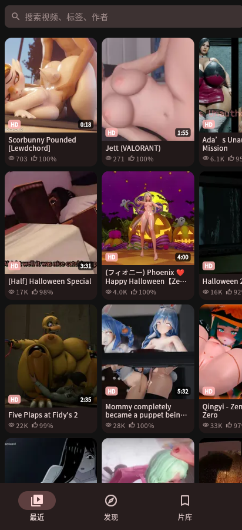
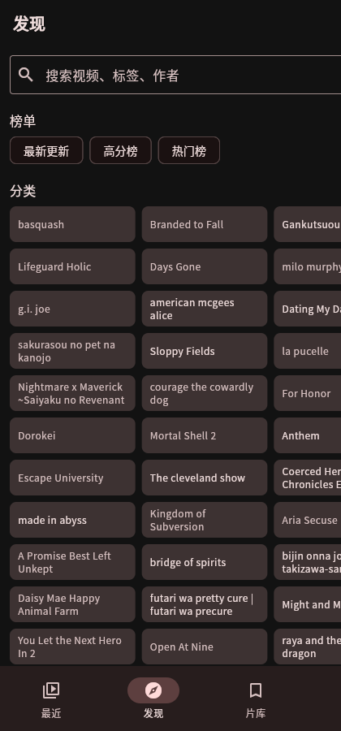
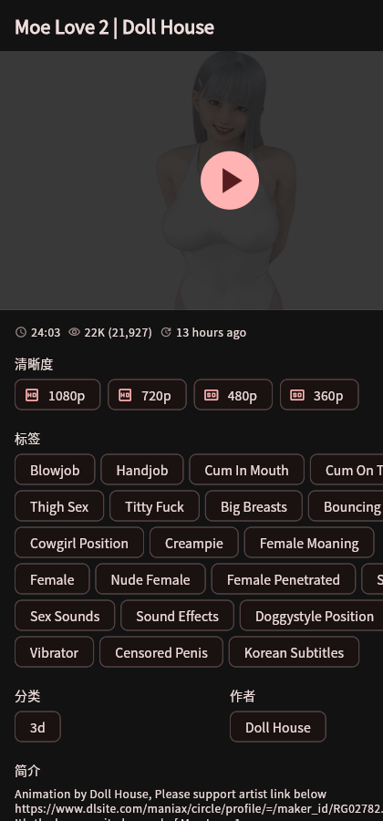
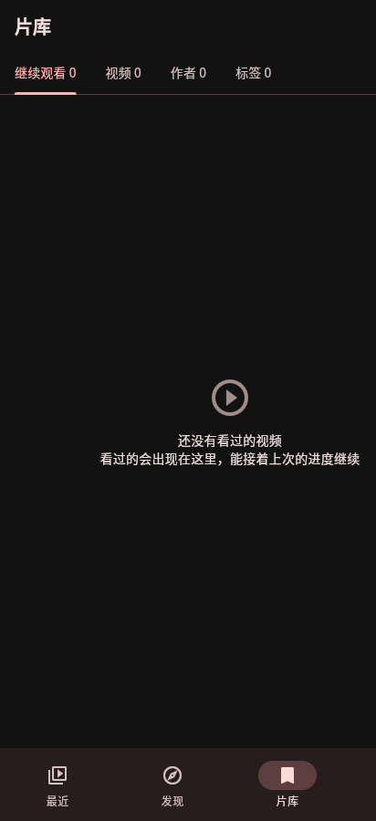

# R34V

rule34video.com 的安卓客户端。**原生应用，不是套壳网页。**

每个界面都用 Flutter 重绘，视频交给系统解码器直接播——没有网页广告、没有弹窗跳转、不用等整页加载。

<br>

<p align="center">
  
  
  
  
</p>

<p align="center">
  <sub>首页 · 发现 · 详情 · 片库</sub>
</p>

<br>

> **本项目与 rule34video.com 无任何关联。** 应用不托管任何内容，所有视频均来自原站。支持登录读取会员内容，不上传、不评论、不评分。仅供个人使用。

[](LICENSE)
[](https://flutter.dev)
[](https://www.android.com)

---

## 目录

- [它解决什么问题](#它解决什么问题)
- [下载安装](#下载安装)
- [功能](#功能)
- [怎么用](#怎么用)
- [常见问题](#常见问题)
- [自己编译](#自己编译)
- [技术说明](#技术说明)
- [开源说明](#开源说明)
- [致谢](#致谢)

---

## 它解决什么问题

用手机浏览器看这个站，会遇到四件烦人事：

1. **全屏按钮经常没反应**，或者转屏后画面尺寸错乱
2. **广告和跳转**——页面上挂着第三方广告脚本，误触就跳走
3. **翻页慢**——每翻一页都要重新加载整个页面
4. **缓冲慢**——浏览器能秒开的视频，别的方式却要等

前三条来自套壳和网页本身，第四条来自网络链路。这个客户端把四条都处理了：原生播放器全屏可靠、没有任何广告、列表滚动即时加载、播放器直接连 CDN 而不反复走跳转。

---

## 下载安装

### 一步到位（推荐）

**https://github.com/ywclgl258/r34v/releases/latest**

打开点最新那个 `R34V-v*.apk` 下载。**不需要登录 GitHub**，手机浏览器直接就能下。

下完点开安装。系统会提示「未知来源应用」，允许即可——应用没上架任何商店，这个提示是正常的。

> 包是 **release 签名**，装新版可以直接覆盖安装，收藏和观看记录都保留，不用先卸载。

### 应用内更新

**设置 → 关于 → 检查更新**。

它会去 GitHub Releases 取最新版，显示版本号、体积和更新说明，点「下载」后显示进度，下完点「安装」直接调起系统安装器。启动时也会静默检查一次（距上次超过 12 小时才查）。

失败时会说清原因：是限流、没权限，还是网络不通。GitHub 的 403 有两种含义（限流 vs 权限不足），应用靠响应体区分——限流等几分钟就好，权限问题重试无用。

### 系统要求

| 项目 | 要求 |
|---|---|
| Android | 8.0（API 26）及以上 |
| 架构 | arm64-v8a |
| 网络 | 能直连站点；DNS 被污染时应用会自动走 DoH |

---

## 功能

### 浏览

**首页**是热门视频轮播——按播放量排序的前 6 条，每 6 秒自动切换，也可以左右滑。手指一碰就暂停轮播 12 秒，避免「刚想看就被切走」。下方是「继续观看」和「最新更新」。

**发现页**把站点的几个入口整合在一屏：

- 排行榜：最新更新 / 高分榜 / 热门榜 / 角色排行 / 作者排行
- 分类：36 个分类的网格，有封面的直接显示
- 角色：按作品分组（站点没有扁平的角色索引，`/characters/` 是 404）
- 作者 / 标签：完整索引

**搜索**支持视频、标签、作者三种目标，带历史记录。

**列表页**两列网格（横屏自动改三列），滚动即时加载下一页，支持下拉刷新。

### 观看

**详情与播放合一**——点开视频直接是播放页，往下滚就是详情：清晰度切换、角色/分类/作者标签、可长按收藏。

**播放器**基于 `media_kit`（libmpv）或 `video_player`（ExoPlayer），可在设置里切换：

- 全屏、倍速（0.25×–3×）、音量、亮度（左侧竖滑）
- 左右滑动快进后退，双击左/右 40% 区域 ±10 秒，双击中央切全屏
- **竖屏视频全屏时自动转竖屏**，不会左右留两条大黑边
- 断点续播：退出时记住位置，下次进来自动跳回

### 收藏与记录

**片库**分六类：观看记录、视频、角色、作者、标签、缓存。

- 观看记录保留全部历史（含已看完的），带进度条
- 角色/作者/标签在详情页**长按**即可收藏
- 看完的视频显示「已看完」，点进去从头播

### 本地缓存与后台下载

两种模式：

| 模式 | 行为 |
|---|---|
| **边下边播** | 播放的同时往磁盘写，缓冲 512KB 就能起播 |
| **完整下载** | 下完才能播，但保证文件完整、可离线 |

下载走**多线程分段**（默认关闭，设置里可开），带前台服务保活，切后台不中断。片库的「缓存」页签能看列表、单独删除。

### 网络与反污染

这个站点在部分地区会被 DNS 污染。应用内置三层应对：

1. **DoH 解析**——用 Cloudflare / Google 的加密 DNS 拿到真实 IP
2. **IP 直连**——TCP 连 IP、TLS 握手仍对域名，证书校验完整
3. **内置 IP 兜底**——DoH 本身也可能被污染，此时用已知可用的 IP

设置里可以开关、切换 DoH 服务商、手动指定代理。

---

## 怎么用

**第一次打开**：直接就是首页，不用登录也能浏览和播放。

**找东西**：底部「发现」页有榜单和分类；顶部搜索框按标签、作者、视频名搜。

**看视频**：点任意封面进播放页。往下滚是详情，清晰度在这里切。点右上角全屏，或双击画面中央。

**收藏**：详情页的长按是关键——长按角色名收藏角色，长按作者名收藏作者，长按标签收藏标签。视频本身点右上角爱心。

**调整**：底部「设置」里有播放器引擎、下载线程数、DoH、玻璃模糊、应用更新。

---

## 常见问题

### 打开一片空白，或者一直转圈

先确认手机能上外网。如果别的 App 正常、只有它不行，多半是 DNS 污染——去设置里确认 DoH 是开着的。

### 提示「DoH 域名解析失败」

DoH 服务商本身被墙了，换一个（设置里可选 Cloudflare / Google / 阿里）。都失败时会退回内置 IP。

### 明显比以前卡，或者缓冲很慢

检查设置里的代理是不是开着但已经失效。也可以试着切换播放器引擎（ExoPlayer ↔ libmpv），两者对不同编码的表现差别很大。

### 视频播到一半停了，提示「链接过期」

站点的直链带 acctoken，会过期。应用会自动回源重抓；如果反复失败，换一个清晰度试试。

### 收藏的东西重装后没了

收藏和记录存在应用私有目录，卸载会一起清掉。覆盖安装不受影响。

### 缓存了一堆，怎么清

片库 → 缓存页签，可以单条删。全部清空去系统设置里清应用数据。

### 搜索不到想找的内容

站点的搜索是按标签匹配的，不是全文。试试用英文标签名，或者去标签索引里翻。

### 为什么没有 iOS 版

站点内容不符合 App Store 的审核政策。技术上 Flutter 支持，但发不出去。

---

## 自己编译

### 不需要装 Android SDK

用 GitHub Actions 云端构建：

1. Fork 这个仓库
2. 改代码，push 到 `main`
3. 打开仓库的 **Actions** 页签，等构建完成
4. 在该次运行的 **Artifacts** 里下载 `r34v-apk`

工作流在 `.github/workflows/build-apk.yml`，会自动跑 `flutter analyze` 和 `flutter test`，通过了才打包。

### 本地开发命令

```bash
flutter pub get          # 拉依赖
flutter analyze          # 静态检查（CI 会跑）
flutter test             # 单元/组件测试（CI 会跑）
flutter run              # 连真机调试
flutter build apk --release --target-platform android-arm64
```

### 签名配置

正式包需要 `android/key.properties`：

```properties
storeFile=r34v-release.jks
storePassword=你的密码
keyAlias=r34v
keyPassword=你的密码
```

没有这个文件时会自动退回 debug 签名（能装，但不能覆盖 release 版）。

CI 里签名走 Secrets：`KEYSTORE_BASE64`、`KEYSTORE_PASSWORD`、`KEY_ALIAS`、`KEY_PASSWORD`。没配就退回 debug 签名，构建照常成功。

---

## 技术说明

### 为什么不套壳 WebView

站点是纯 HTML + 服务端渲染，没有 JSON API。套壳本该是最省事的方案，但实际用下来有三个绕不过去的问题：

1. **全屏不可靠**——网页的 fullscreen API 在 Android WebView 里行为不一致，转屏后尺寸经常错
2. **广告脚本无法完全屏蔽**——注入 JS 拦一层，站点改一次就失效
3. **没法做原生交互**——长按收藏、手势调亮度这些都得自己实现

所以选择重写 UI、只复用站点的 HTML 作为数据源。代价是每次站点改版都要跟着改解析器。

### 数据从哪来

全部靠解析 HTML。核心解析器在 `lib/data/parsing/`：

| 文件 | 负责 |
|---|---|
| `listing_parser.dart` | 列表页、分类/标签/作者索引 |
| `detail_parser.dart` | 视频详情（标题、清晰度、标签、作者） |
| `search_parser.dart` | 搜索结果 |
| `ranking_parser.dart` | 各类榜单 |

站点用大量懒加载——`img.src` 是 1px 的 base64 gif，真链在 `data-rd-src`。解析时必须走 `_resolveThumb`，否则图片全是空白（这个坑踩过，见 `extractLinks` 的注释）。

### CDN 直链：缓冲提速的关键

站点的播放地址是 `/get_file/...`，带 `?v-acctoken=`。直接把它交给播放器有两个问题：一是每次播放都要走一次 302，二是 acctoken 会过期。

`StreamResolver` 用一个 `Range: bytes=0-0` 的请求只取响应头，从 `Location` 里拿到 CDN 直链并缓存。播放器直接连 CDN，省掉跳转。

**注意**：解析这一步必须和主请求共用同一个 DoH 连接器。早先漏传了，导致系统 DNS 被污染时解析必然失败，拿不到直链，播放器只能去连被污染的 IP——表现就是 `Failed to open`。

### DoH：解决「IP 会过期」

站点域名在部分网络下解析到的是污染 IP（实测拿到过 `192.133.77.133`，根本连不通）。

解法是 DoH 拿到真实 IP，然后**TCP 连 IP、TLS 握手仍对域名**——这样证书校验是完整的，不是「关掉校验硬连」。实现见 `host_router.dart` 的 `connectViaIp`。

关键细节：`HttpClient.connectionFactory` 必须设在 HttpClient 实例上，设在 Dio 上无效。而且 `IOHttpClientAdapter` 要用 `createHttpClient` 回调，在回调里装 factory。

**ExoPlayer 无法注入 IP**——它用 OkHttp 自己的连接栈，Dart 层怎么配都管不到。所以在「无代理 + 默认引擎 + DoH 开启」时，播放器会自动切到 libmpv。

### 多线程分段下载默认是关的

实测在这类线路上，分段下载对整体耗时帮助有限，反而更容易触发站点风控。默认单线程，需要的在设置里开。

### Cookie 会持久化

登录态存在 `SharedPreferences`，重启不丢。用 `dart:io` 的 `Cookie` 序列化，不用 WebView 那套。

### 项目结构

```
lib/
├── app/            路由、全局 provider
├── core/           常量、播放器引导
├── data/
│   ├── local/      本地存储、缓存、下载器
│   ├── parsing/    HTML 解析器
│   └── remote/     网络层（SiteClient、DoH、解析器）
├── domain/         数据模型
├── features/       各页面（feed / explore / player / library / search / settings）
└── ui/             设计系统（tokens、components、glass、net_image）
```

### 已经处理好的失败情况

- **DNS 污染**：DoH → 内置 IP 兜底
- **acctoken 过期**：403/410 自动回源重抓
- **站点改版**：`ParseException` 会说明哪个选择器失效了，不会静默返回空列表
- **列表重复**：单页内和跨页都按 id 去重（重复会让 ListView 抛 key 冲突）
- **图片内存爆掉**：`NetImage` 按显示宽度限制解码尺寸（不限制的话，一张 1000×2000 的封面就吃 8MB+，首屏十几张直接 OOM，表现是图片纯黑）
- **缓存写坏**：格式不合法就当没有，不让一条坏数据卡住首屏

### 性能与缓存策略

列表页是 **stale-while-revalidate**：

```
进入 → 同步读缓存（立刻渲染）→ 后台请求 → 拿到新数据后替换
```

缓存只存第 1 页，最多 24 个列表。超过 30 分钟标记为 stale 但仍会先展示——**过期不等于不可用**，用户看到几分钟前的内容远好过白屏。

刷新失败时不会把内容替换成错误页，只在顶部挂一条提示。

封面有内存 + 磁盘两层：内存 LRU 300 张，磁盘 200MB 按最后访问时间淘汰。磁盘层是「二进 App 封面立刻出来」的前提。

### 没做的

- 评论、上传、评分（只读客户端）
- 下载队列的暂停/恢复（只能取消重来）
- 多语言界面（只有中文）

---

## 开源说明

### 许可

[MIT](LICENSE) © 2026 ywclgl258

可以自由使用、修改、分发、商用，保留版权声明即可。

### 关于内容

这个项目**不包含、不托管、不分发任何视频内容**。它做的全部事情是：把 rule34video.com 的网页解析成结构化数据，用原生界面呈现，把播放地址交给系统播放器。

内容合规性由原站负责，使用者需自行确认所在地区的法律规定。

### 可以拿去做什么

- 学习 Flutter 的界面组织、状态管理、自定义播放器
- 参考 DoH + IP 直连这类网络方案（这套思路对任何被 DNS 污染的场景都适用）
- Fork 后改成别的站点客户端——解析层和 UI 层是分开的

### 不接受什么

- 不接受「帮我加广告」「帮我加付费墙」这类 PR
- 不接受把内容缓存下来再分发的改动（这会让项目变成盗版分发工具）

### 参与

Issue 和 PR 都欢迎。提 bug 时请带上：

- 设备型号和 Android 版本
- 具体操作步骤
- `adb logcat -s flutter` 的相关输出

解析器相关的 bug 请附上出问题的页面 HTML 片段（可以脱敏），否则很难判断是哪个选择器失效了。

---

## 致谢

- [Flutter](https://flutter.dev) — 跨平台 UI 框架
- [media_kit](https://github.com/media-kit/media-kit) — libmpv 的 Flutter 封装
- [Riverpod](https://riverpod.dev) — 状态管理
- [go_router](https://pub.dev/packages/go_router) — 路由
- [Dio](https://pub.dev/packages/dio) — HTTP 客户端
- [Han1meViewer](https://github.com/YenalyLiew/Han1meViewer) — 早期方案参考
